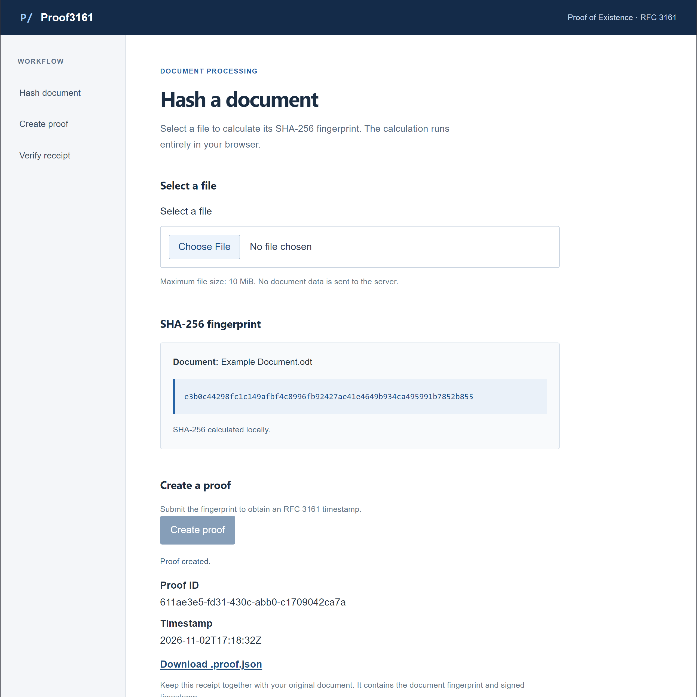
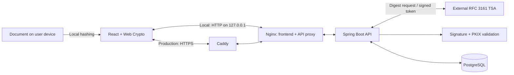

# Proof3161

[](https://docs.oracle.com/en/java/javase/25/)
[](https://docs.spring.io/spring-boot/reference/)
[](https://react.dev/learn)
[](https://www.postgresql.org/docs/18/)
[](https://docs.docker.com/compose/)
[](https://github.com/Tokagero8/Proof3161/actions/workflows/ci.yml)

**Proof of Existence through RFC 3161 trusted timestamping.** Proof3161 is a Java/Spring Boot and React application that obtains signed timestamp evidence for a document and later verifies that evidence against the original file. It is not a blockchain application.

The browser calculates SHA-256 locally: **original document bytes are never uploaded during normal creation or verification workflows**. The backend validates the timestamp signature and certificate path against a deliberately configured TSA trust anchor, including revocation checks.

Built as a portfolio project, it brings together PKI integration, REST APIs, PostgreSQL persistence, automated testing, and container deployment. **Amazon Lightsail deployment is planned; no public demo is available yet.**

[Quick start](#quick-start) · [Architecture](#architecture) · [API](#api-overview) · [Testing](#testing-and-ci) · [Security and limitations](#security-privacy-and-limitations)

## Application preview



*A real proof-creation result: local hashing, a saved timestamp, and a portable receipt ready to download.*

## Key features

- **Local document hashing:** SHA-256 with Web Crypto; only the digest is submitted for timestamping.
- **Validated timestamp evidence:** RFC 3161 request/response checks, signature verification, and PKIX/revocation validation.
- **Portable receipts:** export `.proof.json` and verify against an independently hashed document without the original database row.
- **Explicit verdicts:** `VALID`, `INVALID`, or `INDETERMINATE`, kept separate from network and operation errors.
- **Persistent proofs:** PostgreSQL, Flyway migrations, and a separate non-superuser application identity.
- **Layered verification:** backend and database tests, real archived-token regressions, mocked browser/proxy tests, and GitHub Actions CI.

## How it works

1. **Select a document.** The browser reads it locally and calculates its SHA-256 fingerprint.
2. **Create a proof.** An explicit action sends only the fingerprint to the backend.
3. **Request a timestamp.** The backend sends the digest and a nonce to the configured TSA.
4. **Validate and save.** The backend checks the response against the request, validates the signed token and certificate trust, then persists the proof.
5. **Download the receipt.** Save the portable JSON receipt alongside the original document.
6. **Verify later.** Select the document and receipt. The browser hashes the document again and sends that independent hash with the receipt to the backend for cryptographic verification.

**Original document bytes are not uploaded during either workflow.** Hashing and receipt structure checks happen in the browser; timestamp signature, certificate, and evidence validation happen on the backend.

| Outcome | Meaning |
| --- | --- |
| `VALID` | The signed evidence, document digest, and receipt metadata agree under the server's configured trust policy. |
| `INVALID` | A definite failure was detected, such as a digest mismatch, altered signed content, or a revoked signing certificate. |
| `INDETERMINATE` | Verification could not establish a result, for example because certificate trust or necessary evidence was unavailable. |

HTTP errors, rate-limit responses, network failures, and timeouts are operation failures, not cryptographic verdicts.

## Technology stack

| Area | Implementation |
| --- | --- |
| Backend | Java 25, Spring Boot 4.1.1, Spring MVC, Bean Validation, Spring Data JPA |
| Cryptography | Bouncy Castle 1.86; JDK PKIX certificate-path and revocation validation |
| Persistence | PostgreSQL 18.3; Flyway managed through Spring Boot; Hibernate schema validation |
| Frontend | React 19.3.1, TypeScript 6.0.3, Vite 8.3.4, Web Crypto |
| Build | Gradle wrapper 9.7.1; Node.js 24; npm lockfile |
| Containers | Docker Compose, unprivileged Nginx, Caddy 2 for production HTTPS |
| Tests | JUnit Jupiter, Mockito, MockMvc, Testcontainers, Vitest, React Testing Library, Playwright Chromium |
| CI | GitHub Actions on Ubuntu 24.04 |

Frontend versions above are resolved by the [lockfile](frontend/package-lock.json), rather than inferred from the compatible ranges in [package.json](frontend/package.json). The [backend Dockerfile](Dockerfile) pins the Temurin JDK/JRE images by SHA-256 digest; the verified runtime baseline is **25.0.5+8**. These pins require deliberate maintenance as security updates become available.

## Quick start

Use Docker Desktop with Linux containers (or Docker Engine and Compose). Host Java and Node.js are not needed to run the containerized application.

1. Clone the repository and create `.env` from `.env.example`; see [fresh-clone setup](#configure-a-fresh-clone).
2. Set separate database passwords and the TSA URL, then [provision an independently trusted TSA root](#provision-the-tsa-signing-trust-anchor).
3. From the configured repository root, start the local stack:

```powershell
.\scripts\start-app.bat
```

Open **http://127.0.0.1:8088/** (or your configured `HTTP_PORT`). Select a document, create a proof, download its receipt, then verify the receipt with the same document.

Stop with `.\scripts\stop-app.bat`; persisted database data is retained. Linux/macOS commands and troubleshooting are in [detailed setup](#getting-started-with-docker-compose).

## Architecture

The backend is a modular monolith. Plain Java services depend on repository and timestamping interfaces; HTTP, JPA, and RFC 3161 adapters implement those boundaries.



Requests and responses follow the same proxy chain: **browser ↔ Nginx ↔ backend** locally, or **browser ↔ Caddy ↔ Nginx ↔ backend** in production.

- **Frontend:** file selection, hashing, receipt parsing, explicit requests, and separate verdict/error states.
- **Backend:** API validation, proof orchestration, persistence, and portable verification.
- **TSA adapter:** requests timestamps and verifies response status, request correspondence, and signed evidence before saving.
- **Verification:** validates the CMS timestamp signature and signer, builds a path to the configured trust anchor with revocation enabled, and compares authenticated hash/time values with the supplied document digest and receipt metadata.
- **PostgreSQL:** stores proof identifiers, hashes, timestamp tokens, and timestamps. Flyway owns schema changes; Hibernate validates the schema.
- **Proxies:** Nginx serves the frontend and same-origin API routes. Production adds Caddy at the HTTPS edge. Backend and database ports are not published.

The [verification service](src/main/java/io/github/tokagero8/proof3161/verification/VerificationService.java) has no repository dependency. A receipt can therefore be verified without its original database row, but the web workflow still requires a running backend and its configured trust policy. The deployed application also initializes its database connection at startup.

## Getting started with Docker Compose

### Prerequisites

- Git and Docker Desktop using Linux containers, or Docker Engine with Buildx and the Compose plugin.
- **Docker Compose 2.24.4 or newer** for the production override's [`!override` support](https://docs.docker.com/reference/compose-file/merge/#replace-value).
- A modern browser with Web Crypto. Use localhost locally and HTTPS for public access.
- Network access for image/dependency downloads, live TSA requests, and applicable certificate-status services.
- An independently authenticated TSA root CA certificate.

Host Java and Node.js installations are not required for the Compose application. They are needed for running the corresponding test suites directly.

### Configure a fresh clone

Run these commands in PowerShell:

```powershell
git clone https://github.com/Tokagero8/Proof3161.git
Set-Location Proof3161

if (-not (Test-Path -LiteralPath .env)) {
    Copy-Item -LiteralPath .env.example -Destination .env
}
New-Item -ItemType Directory -Path certificates -Force | Out-Null
```

Edit the new `.env` using [.env.example](.env.example) as the configuration reference:

| Variable | Local setup |
| --- | --- |
| `HTTP_PORT` | Defaults to `8088`; published only on `127.0.0.1`. |
| `DB_NAME` | Dedicated application database; default `proof3161`. |
| `POSTGRES_ADMIN_USERNAME` | Bootstrap administrator; default `proof3161_admin`. |
| `POSTGRES_ADMIN_PASSWORD` | Set a strong password; the example intentionally leaves it empty. |
| `DB_USERNAME` | Separate application/Flyway role; default `proof3161_app`. |
| `DB_PASSWORD` | Set a distinct strong password; the example intentionally leaves it empty. |
| `TSA_URL` | RFC 3161 endpoint; the example uses `https://freetsa.org/tsr`. |
| `TSA_ROOT_CERT_FILE` | Host certificate path, relative to the base Compose file; default `./certificates/tsa-root.pem`. |
| `PUBLIC_DOMAIN`, `ACME_EMAIL` | Used only by the production HTTPS override. |

Keep the administrator and application usernames distinct. The application role can create objects in its schema for Flyway, but is not a database superuser. Keep `.env` and local certificate provisioning out of Git.

### Provision the TSA signing trust anchor

Choose a CA deliberately, using the TSA provider's authenticated certificate distribution and independently checked identity/fingerprint information. Do not automatically trust a root embedded in a received timestamp.

For the FreeTSA example, its [official site](https://freetsa.org/index_en.php) publishes the CA certificate and a SHA-256 file hash. In a fresh clone, retrieve the **CA certificate**, not the TSA leaf signing certificate:

```powershell
Invoke-WebRequest -UseBasicParsing -Uri 'https://freetsa.org/files/cacert.pem' -OutFile '.\certificates\tsa-root.pem'
Get-FileHash -LiteralPath '.\certificates\tsa-root.pem' -Algorithm SHA256
```

Compare the result with the provider's authenticated published value before proceeding. If it differs, stop and investigate; do not bypass validation. A matching download hash establishes file identity, not a universal guarantee about the CA. No private key is needed.

Compose mounts this file read-only at `/run/certificates/tsa-root.pem` and explicitly sets the backend's `TSA_TRUSTED_ROOT_PATH` to that container path. This is **timestamp-signing trust**, separate from Java's HTTPS trust store. The historical test fixture certificate is not automatically a production trust decision.

### Start, inspect, and stop

On Windows, run the launchers from PowerShell or Command Prompt:

```powershell
.\scripts\start-app.bat
```

The launcher checks Docker, resolves the local Compose configuration, checks that the TSA certificate file exists, and builds/starts the application. It does not authenticate the certificate for you.

Open **http://127.0.0.1:8088/**, or the port selected by `HTTP_PORT`. Select a small document, create a proof, download its receipt, and use **Verify receipt** with the same document. Creation requests a new timestamp from the live TSA. Verification checks the saved token and may require network access to certificate-status services.

| Launcher | Purpose |
| --- | --- |
| [start-app.bat](scripts/start-app.bat) | Build and start the local stack; wait for healthy services. |
| [app-status.bat](scripts/app-status.bat) | Show service status. |
| [app-logs.bat](scripts/app-logs.bat) | Follow logs; press Ctrl+C to stop following. |
| [stop-app.bat](scripts/stop-app.bat) | Stop and remove containers while retaining database volumes. |

The launchers use Windows PowerShell 5.1 and the shared `scripts/run.ps1` helper. They resolve the repository directory automatically and return a nonzero exit code on failure. App commands explicitly use the local `compose.yaml`, `.env`, and project name `proof3161`; they do not select the production override.

On Linux/macOS, or when running Docker directly from the repository root:

```bash
docker compose -f compose.yaml config --quiet
docker compose -f compose.yaml up -d --build --wait
docker compose -f compose.yaml ps
```

Health checks establish application/database startup, not TSA availability. A missing certificate file prevents startup. Certificate-path or revocation failures require checking the root, chain, and evidence availability rather than disabling validation.

Stop the local stack with:

```powershell
.\scripts\stop-app.bat
```

The direct equivalent is `docker compose -f compose.yaml down`. This retains the named PostgreSQL volume. **`docker compose down -v` deletes named volumes and can destroy persisted database data.** Volumes provide persistence, not backups. Changing database credentials in `.env` does not update roles/passwords in an existing volume: the [bootstrap script](deploy/postgres/10-create-app-role.sh) runs when PostgreSQL initializes an empty data directory.

Shell environment variables can override Compose's `.env` values. Spring Boot and Gradle do not automatically load this file when run outside Compose.

## API overview

The local API is available through Nginx at `http://127.0.0.1:8088/api/v1`. Requests and responses use JSON.

| Method and route | Contract |
| --- | --- |
| `POST /api/v1/proofs` | Accepts `documentHash`: exactly 64 hexadecimal SHA-256 characters. Returns `201`, a `Location` header, and the persisted proof. |
| `GET /api/v1/proofs/{id}` | Returns a proof by UUID, or `404`. |
| `GET /api/v1/proofs/{id}/receipt` | Returns an attachment named `proof3161-{id}.proof.json`, or `404`. |
| `POST /api/v1/verifications` | Accepts an independently calculated `documentHash` and a nested `portableProof` object. Returns a verification outcome. |

Creation/retrieval responses contain `id`, `hashAlgorithm`, `documentHash`, `timestampAt`, `timestampTokenBase64`, and `createdAt`. The receipt contains exactly these **five** fields:

```json
{
  "version": "1",
  "hashAlgorithm": "SHA256",
  "documentHash": "0000000000000000000000000000000000000000000000000000000000000000",
  "timestampAt": "2026-01-01T00:00:00Z",
  "timestampTokenBase64": "AQID"
}
```

This is an illustrative structure, **not valid timestamp evidence**: `AQID` is arbitrary sample bytes. Use a real downloaded receipt for verification. Receipt metadata is checked against signed token data; it is not trusted merely because the JSON parses.

A verification response contains `status`, `reason`, and `timestampAt`. All three verdicts use HTTP `200`; only `VALID` returns an authenticated timestamp, while the other outcomes return `null`. Invalid request input returns `400`. Timestamp acquisition/validation failure during creation returns `502`; no proof is saved for that failure.

The [proof controller](src/main/java/io/github/tokagero8/proof3161/proof/api/ProofController.java) and [verification request DTO](src/main/java/io/github/tokagero8/proof3161/verification/api/VerifyProofRequest.java) define the contracts. There is no document-upload endpoint.

## Testing and CI

### Backend and archived cryptographic tests

Install a Java 25 JDK, set `JAVA_HOME` appropriately, and keep Docker running for PostgreSQL Testcontainers. No separately provisioned application database is needed.

Run both backend suites from the repository root:

```powershell
.\scripts\test-backend.bat
```

[test-backend.bat](scripts/test-backend.bat) temporarily clears the live TSA environment variables and explicitly runs `test` and `offlineProofTest`. Ordinary tests cover domain/unit behavior, MockMvc contracts, and PostgreSQL integration, including restricted-role access, Flyway, token-byte persistence, and receipt export.

On Linux/macOS:

```bash
env -u TSA_URL -u TSA_TRUSTED_ROOT_PATH bash ./gradlew --no-daemon test offlineProofTest
```

To run only the archived suite, use `./gradlew.bat --no-daemon offlineProofTest` on Windows or `bash ./gradlew --no-daemon offlineProofTest` on Linux/macOS.

The [seven-case suite](src/test/java/io/github/tokagero8/proof3161/verification/Rfc3161PortableProofIntegrationTest.java) uses a saved real timestamp, certificates, and CRLs. It checks fixture integrity, valid evidence, document/metadata mismatches, signed-content tampering, and an unrelated trust anchor.

**`offlineProofTest` is not included automatically in `test`, `check`, or `build`.** It needs no running database or new TSA request. It uses local evidence and disables selected certificate-fetch mechanisms, but does **not enforce total network isolation**. Gradle's `--offline` option is not a runtime network sandbox.

HTML reports are written to `build/reports/tests/test/index.html` and `build/reports/tests/offlineProofTest/index.html`. For direct Gradle commands, add `--rerun-tasks` when fresh execution is required.

<details>
<summary>Optional live TSA integration tests</summary>

These tests require a reachable TSA, the independently chosen root, and available certificate-status evidence. They are intentionally excluded from ordinary CI by clearing the enabling environment variables.

```powershell
$savedTsaUrl = $env:TSA_URL
$savedTsaRoot = $env:TSA_TRUSTED_ROOT_PATH
try {
    $env:TSA_URL = 'https://freetsa.org/tsr'
    $env:TSA_TRUSTED_ROOT_PATH = (Resolve-Path '.\certificates\tsa-root.pem').Path
    .\gradlew.bat test --tests '*Rfc3161ExternalIntegrationTest' --rerun-tasks
    if ($LASTEXITCODE -ne 0) { throw 'Live TSA integration tests failed.' }
}
finally {
    $env:TSA_URL = $savedTsaUrl
    $env:TSA_TRUSTED_ROOT_PATH = $savedTsaRoot
}
```

</details>

### Frontend and browser tests

Use Node.js 24. Install dependencies and Chromium explicitly before the first run (repeat `npm.cmd ci` after lockfile changes):

```powershell
Push-Location frontend
try {
    npm.cmd ci
    if ($LASTEXITCODE -ne 0) { throw 'Dependency installation failed.' }
    & .\node_modules\.bin\playwright.cmd install chromium
    if ($LASTEXITCODE -ne 0) { throw 'Chromium installation failed.' }
}
finally { Pop-Location }
```

Then run the launchers:

```powershell
.\scripts\test-frontend.bat
.\scripts\test-browser.bat
```

[test-frontend.bat](scripts/test-frontend.bat) runs Vitest, ESLint, and the production build, stopping at the first failure. [test-browser.bat](scripts/test-browser.bat) runs Chromium with one worker and explicit timeouts. Neither launcher installs dependencies. Playwright builds the application through its configured web server command.

On Linux/macOS, from `frontend/`:

```bash
npm ci
./node_modules/.bin/playwright install chromium
npm test
npm run lint
npm run build
./node_modules/.bin/playwright test --project=chromium --workers=1 --timeout=30000 --global-timeout=600000
```

Vitest and React Testing Library cover hashing, receipt parsing, API behavior, and UI states. Playwright exercises real browser file APIs and Web Crypto with intercepted API responses. It starts its own preview server on `127.0.0.1:4173`; keep that port free. It needs neither the Compose stack nor live FreeTSA access.

Linux runners also need Playwright's browser system dependencies, as configured in CI.

### Container checks and CI

With local Compose configuration provisioned, run the checks below. The production override also requires nonempty `PUBLIC_DOMAIN` and `ACME_EMAIL`. For **configuration validation only**, the example values `proof.example.com` and `admin@example.com` from `.env.example` are sufficient; add them to your `.env` if missing. Use your real domain and monitored email before public startup. `config --quiet` neither starts Caddy nor requests a certificate.

```powershell
docker compose build backend frontend
docker compose -f compose.yaml config --quiet
docker compose -f compose.yaml -f compose.production.yaml config --quiet
```

The [CI workflow](.github/workflows/ci.yml) runs backend tests and packaging, explicitly runs the archived suite, checks critical test counts and rejects skipped required suites, runs frontend tests/lint/build and Chromium, and validates both Compose configurations. It uploads test reports and browser failure evidence. It does not deploy infrastructure, start the complete application stack, or call the live TSA.

<details>
<summary>Deterministic production-proxy smoke tests</summary>

The [proxy harness](deploy/tests/check.py) uses a synthetic backend to test forwarding, headers, receipt routing, and independent rate/concurrency limits. It is separate from the cryptographic tests and CI.

Run from the repository root with Docker available. Do not run alongside a production stack using the same fixed `172.30.90.0/29` subnet. Port `8099` must be free. This creates a temporary HTTP-only Caddy test listener without changing the production file or requesting public certificates.

```powershell
.\scripts\test-proxy.bat
```

[test-proxy.bat](scripts/test-proxy.bat) uses the shared PowerShell helper to create a temporary Caddyfile and a unique Compose project, run all scenarios, and remove its test containers and temporary configuration even after a test failure. If container cleanup fails, it reports the project name and retains the configuration for recovery.

Expect successful `nginx -t` and seven `PASS:` lines. Recreating Nginx clears rate-limit state between scenarios. These tests do not establish public TLS issuance or live TSA connectivity.

</details>

## Security, privacy, and limitations

- **Digest-only is not anonymous.** Document contents stay local during normal workflows, but hashes can identify known documents or correlate submissions. Receipts expose their digest and timestamp.
- **Trust is explicit.** The configured root CA establishes signing trust. An embedded signer certificate or valid signature alone does not. PKIX path/revocation checks have a separate responsibility from token-signature validation.
- **Verification depends on evidence.** Missing trust or certificate-status evidence can produce `INDETERMINATE`. Production does not automatically load the archived test CRLs.
- **The claim is limited.** A trusted timestamp supports existence at or before the signed generation time under the applicable cryptographic and TSA assumptions. It does not prove authorship, ownership, originality, exact creation time, or universal legal validity.
- **Receipts are portable, not a complete archival system.** They do not provide comprehensive long-term revocation evidence preservation, trust-policy history, or evidence renewal as algorithms and certificates age.
- **Access is public by design.** There is no user-account or per-user authorization layer. The API is not private document storage.
- **Resource limits are deliberate.** The UI accepts documents up to 10 MiB and receipt files up to 128 KiB; decoded tokens are limited to 64 KiB. Nginx caps request bodies at 256 KiB.
- **Deployment controls have a defined scope.** Production Nginx applies separate proof/verification rate and connection limits, trusted forwarding, and basic security headers. HTTP 429/503 does not mean a document failed verification. Backend/frontend containers run without root, with read-only root filesystems and limited capabilities.
- **This is a portfolio/educational project**, not a certified or qualified timestamping service. The application's availability and successful live verification depend on external services.


## License

This project is licensed under the MIT License - see the [LICENSE](LICENSE) file for details.
